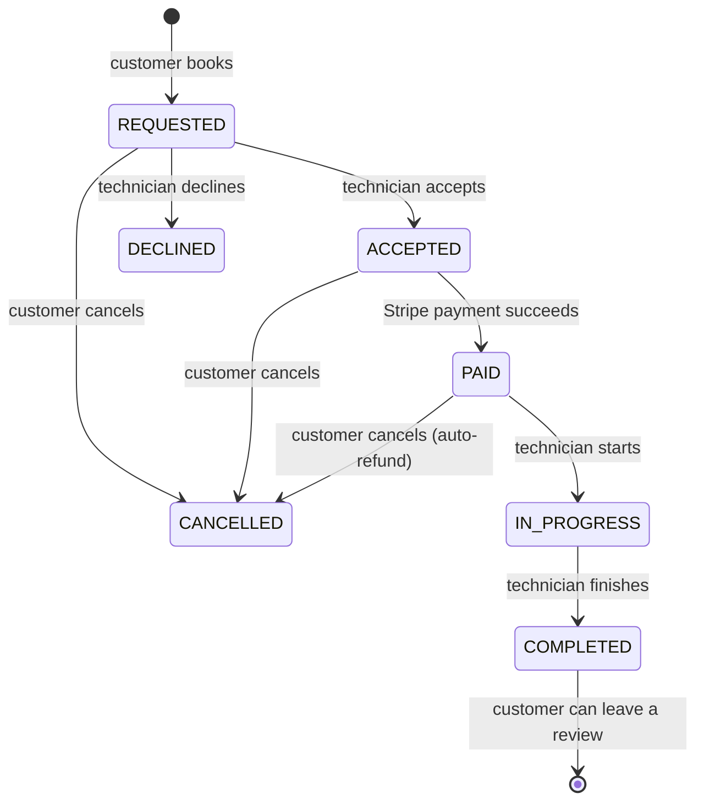
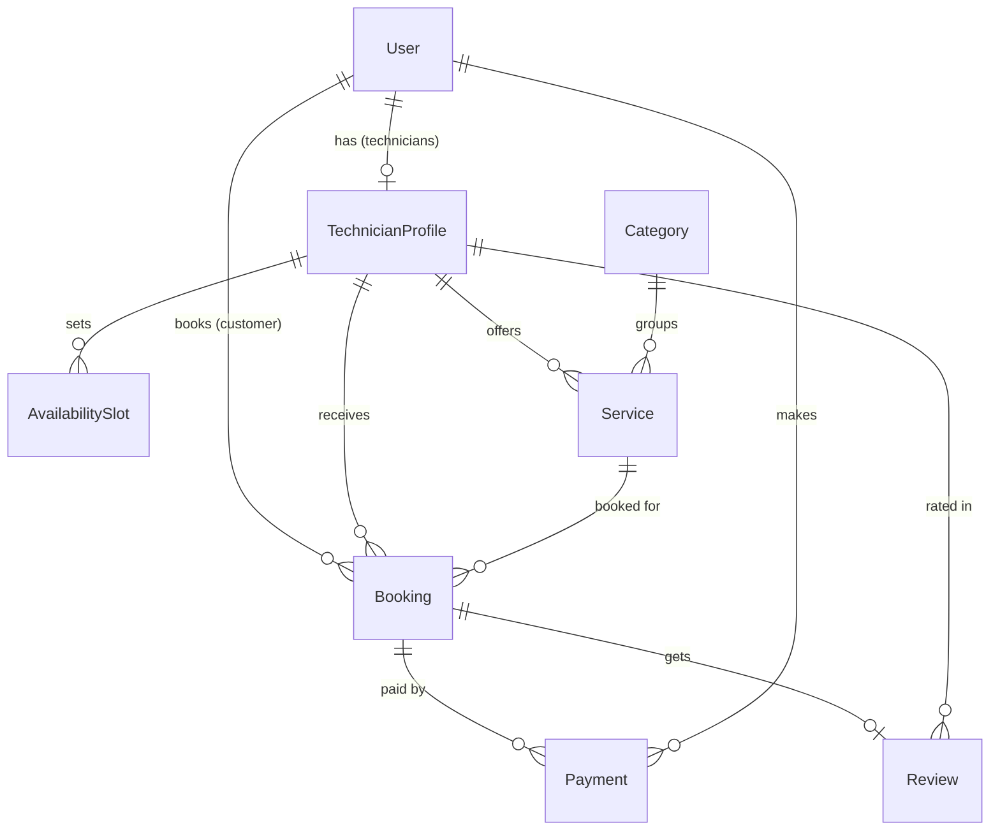

<div align="center">

# 🔧 FixItNow API

**Your trusted home service platform — backend**

Book verified technicians for plumbing, electrical work, cleaning, AC repair and more.
Pay securely with Stripe, track every job, and leave a review when it's done.


</div>

---

## 📌 Submission details

| Item | Link / Value |
|------|--------------|
| **Backend repo** | https://github.com/superSimpleJahir/level2-assignment-4 |
| **Live API** | https://fixitnow-backend-gilt.vercel.app &nbsp;→&nbsp; [health check](https://fixitnow-backend-gilt.vercel.app/api/health) |
| **API docs (Swagger)** | https://fixitnow-backend-gilt.vercel.app/api/docs |
| **API docs (Postman)** | [`docs/FixItNow.postman_collection.json`](./docs/FixItNow.postman_collection.json) — import it and set `baseUrl` to `https://fixitnow-backend-gilt.vercel.app/api` |
| **Demo video** | `<your video link>` |

### 🔑 Demo accounts

These work on the live API above and are created by the seed script (`npm run db:seed`).

| Role | Email | Password |
|------|-------|----------|
| **Admin** | `admin@fixitnow.com` | `Admin@12345` |
| **Customer** | `tania@example.com` | `Customer@123` |
| **Technician** | `rahim.plumber@fixitnow.com` | `Tech@12345` |

> Other seeded technicians: `karim.electric@`, `sumaiya.clean@`, `nasir.ac@` (all `@fixitnow.com`, same password).

---

## 📖 Table of contents

- [What is FixItNow?](#-what-is-fixitnow)
- [Features](#-features)
- [Tech stack](#-tech-stack)
- [Getting started](#-getting-started)
- [Environment variables](#-environment-variables)
- [Available scripts](#-available-scripts)
- [Project structure](#-project-structure)
- [API overview](#-api-overview)
- [How a booking works](#-how-a-booking-works)
- [Payments with Stripe](#-payments-with-stripe)
- [Error handling & validation](#-error-handling--validation)
- [Database design](#-database-design)
- [Testing](#-testing)
- [Deployment](#-deployment)

---

## 🏠 What is FixItNow?

FixItNow is a marketplace backend that connects people who need something fixed with people who can fix it.

- **Customers** browse services, pick a technician and a time slot, pay online and rate the work.
- **Technicians** publish the services they offer, set their weekly availability and manage incoming jobs.
- **Admins** keep the platform healthy: managing users, categories, bookings and payments.

The API is a REST API that returns JSON and uses JWT bearer tokens for authentication.

---

## ✨ Features

**For everyone (public)**
- Browse services and technicians
- Search, filter (category, city, price range, rating, skill), sort and paginate
- Technician profile with services, weekly availability and customer reviews

**For customers**
- Register / login, update profile, change password
- Book a technician for a specific date and time
- Pay through **Stripe Checkout** once the technician accepts
- Payment history and status tracking
- Cancel before the job starts (paid bookings are **refunded automatically**)
- Review a technician after the job is completed

**For technicians**
- Maintain a profile (skills, experience, hourly rate, city)
- Create and manage the services they offer
- Set weekly availability slots
- Accept or decline requests, start the job and mark it complete

**For admins**
- View all users, ban / unban accounts
- View every booking and payment
- Create, edit, disable and delete service categories

**Under the hood**
- Role-based access control (customer / technician / admin)
- Double-booking protection and availability checks
- Zod validation on every endpoint and a consistent error format
- Idempotent payment confirmation (works from both the redirect flow and the webhook)
- Rate limiting, Helmet security headers, CORS

---

## 🧰 Tech stack

| Layer | Technology |
|-------|------------|
| Runtime | Node.js + Express 4 |
| Language | TypeScript |
| Database | PostgreSQL |
| ORM | Prisma 6 (schema, migrations, seed) |
| Auth | JWT + bcrypt |
| Validation | Zod |
| Payments | Stripe Checkout + webhooks |
| Docs | Swagger UI (OpenAPI 3) + Postman collection |
| Deployment | Vercel or Render |

---

## 🚀 Getting started

### Prerequisites

- **Node.js 18+**
- **PostgreSQL** running locally (or a hosted one such as Neon / Supabase / Render)
- A free **Stripe** account in *test mode* (only needed to try real payments)

### 1. Clone and install

```bash
git clone <your-repo-url> fixitnow-backend
cd fixitnow-backend
npm install
```

### 2. Create your `.env`

```bash
cp .env.example .env
```

Then open `.env` and fill in at least `DATABASE_URL` and `JWT_SECRET`. See [Environment variables](#-environment-variables) for details.

### 3. Create the database

```bash
createdb fixitnow          # or create it from pgAdmin / your hosting dashboard
npm run db:migrate         # applies all migrations
npm run db:seed            # admin + categories + demo technicians and customers
```

### 4. Start the server

```bash
npm run dev
```

The API is now running at **http://localhost:4000**

| URL | What it is |
|-----|------------|
| http://localhost:4000/api/health | Health check |
| http://localhost:4000/api/docs | Swagger UI — try every endpoint in the browser |

---

## 🔐 Environment variables

| Variable | Required | Description |
|----------|:--------:|-------------|
| `PORT` | | Server port (default `4000`) |
| `NODE_ENV` | | `development` or `production` |
| `DATABASE_URL` | ✅ | PostgreSQL connection string |
| `JWT_SECRET` | ✅ | Long random string used to sign tokens (16+ chars) |
| `JWT_EXPIRES_IN` | | Token lifetime, default `7d` |
| `BCRYPT_SALT_ROUNDS` | | Password hashing cost, default `10` |
| `STRIPE_SECRET_KEY` | ✅ for payments | Stripe **test** secret key (`sk_test_...`) |
| `STRIPE_WEBHOOK_SECRET` | ✅ for webhooks | Signing secret (`whsec_...`) |
| `CLIENT_URL` | | Where Stripe redirects the customer after paying |
| `ADMIN_EMAIL` / `ADMIN_PASSWORD` | | Credentials the seed script gives the admin account |

> The app validates these on startup and stops with a clear message if something important is missing. If `STRIPE_SECRET_KEY` is empty the rest of the API still works; only the payment-creation endpoint answers with a clean `503`.

---

## 📜 Available scripts

| Command | What it does |
|---------|--------------|
| `npm run dev` | Start the API with auto-reload |
| `npm run build` | Generate the Prisma client and compile TypeScript to `dist/` |
| `npm start` | Run the compiled server |
| `npm run typecheck` | Type-check without emitting files |
| `npm run db:migrate` | Create / apply migrations in development |
| `npm run db:deploy` | Apply existing migrations (production) |
| `npm run db:seed` | Seed the database (safe to run repeatedly) |
| `npm run db:reset` | Drop, re-migrate and re-seed the database |
| `npm run test:e2e` | Run the end-to-end flow against a running server |
| `npm run docs:postman` | Regenerate the Postman collection from the OpenAPI spec |

---

## 🗂 Project structure

```
fixitnow-backend/
├── api/                    # Vercel serverless entry
├── docs/                   # Postman collection
├── prisma/
│   ├── schema.prisma       # Database models
│   ├── migrations/         # SQL migrations
│   └── seed.ts             # Admin, categories, demo users
├── scripts/
│   ├── e2e.ts              # End-to-end test
│   └── generate-postman.ts # OpenAPI -> Postman
└── src/
    ├── config/             # Validated environment variables
    ├── docs/               # OpenAPI spec + Swagger UI
    ├── lib/                # Prisma and Stripe clients
    ├── middlewares/        # auth, validate, errorHandler, notFound
    ├── modules/            # One folder per feature
    │   ├── auth/           #   routes -> controller -> service -> validation
    │   ├── browse/
    │   ├── bookings/
    │   ├── categories/
    │   ├── payments/
    │   ├── reviews/
    │   ├── technician/
    │   └── admin/
    ├── routes/             # Mounts every module under /api
    ├── utils/              # ApiError, catchAsync, sendResponse, jwt ...
    ├── app.ts              # Express app
    └── server.ts           # Starts the HTTP server
```

Each module follows the same flow: **route** (auth + validation) → **controller** (HTTP only) → **service** (business rules + database).

---

## 🌐 API overview

Base URL: `http://localhost:4000/api`
Protected routes need the header `Authorization: Bearer <token>`.

> 📘 Full request/response details, query parameters and examples live in **Swagger UI (`/api/docs`)** and the **Postman collection**.

### Authentication

| Method | Endpoint | Access | Description |
|--------|----------|--------|-------------|
| POST | `/auth/register` | Public | Register as `CUSTOMER` or `TECHNICIAN` |
| POST | `/auth/login` | Public | Login and receive a JWT |
| GET | `/auth/me` | Any user | Current user |
| PATCH | `/auth/me` | Any user | Update name / phone / address |
| PATCH | `/auth/change-password` | Any user | Change password |

### Public browsing

| Method | Endpoint | Description |
|--------|----------|-------------|
| GET | `/categories` | Active service categories |
| GET | `/services` | Search & filter: `search`, `category`, `location`, `minPrice`, `maxPrice`, `minRating`, `sortBy`, `order`, `page`, `limit` |
| GET | `/services/:id` | Service details |
| GET | `/technicians` | Search & filter: `search`, `category`, `city`, `skill`, `minRating`, `sortBy`, `order`, `page`, `limit` |
| GET | `/technicians/:id` | Profile with services, availability and reviews |

### Bookings

| Method | Endpoint | Access | Description |
|--------|----------|--------|-------------|
| POST | `/bookings` | Customer | Book a technician |
| GET | `/bookings` | Customer, Technician | Own bookings (`?status=`) |
| GET | `/bookings/:id` | Owner, Technician, Admin | Booking details |
| PATCH | `/bookings/:id/cancel` | Customer | Cancel before the job starts |

### Payments (Stripe)

| Method | Endpoint | Access | Description |
|--------|----------|--------|-------------|
| POST | `/payments/create` | Customer | Create a Stripe Checkout session for an accepted booking |
| POST | `/payments/confirm` | Customer | Verify the session with Stripe and mark the booking paid |
| POST | `/payments/webhook` | Stripe | Signed webhook (completed / expired / failed) |
| GET | `/payments` | Customer, Technician | Payment history (`?status=`) |
| GET | `/payments/:id` | Owner, Technician, Admin | Payment details |

### Reviews

| Method | Endpoint | Access | Description |
|--------|----------|--------|-------------|
| POST | `/reviews` | Customer | Review a completed booking (once per booking) |

### Technician management

| Method | Endpoint | Description |
|--------|----------|-------------|
| GET / PUT | `/technician/profile` | View / update profile |
| PUT | `/technician/availability` | Replace weekly availability slots |
| GET / POST | `/technician/services` | List / create services |
| PUT / DELETE | `/technician/services/:id` | Update / remove a service |
| GET | `/technician/bookings` | Incoming bookings |
| PATCH | `/technician/bookings/:id` | Accept, decline, start (`IN_PROGRESS`) or `COMPLETED` |

### Admin

| Method | Endpoint | Description |
|--------|----------|-------------|
| GET | `/admin/users` | List users (`role`, `status`, `search`) |
| PATCH | `/admin/users/:id` | Ban / unban a user |
| GET | `/admin/bookings` | All bookings |
| GET | `/admin/payments` | All payments |
| GET / POST | `/admin/categories` | List / create categories |
| PUT / DELETE | `/admin/categories/:id` | Update, disable or delete a category |

---

## 🔄 How a booking works



Rules the API enforces for you:

- A booking must start **inside the technician's weekly availability** and fit the whole service duration (times are in **UTC**).
- A technician can't be **double booked** — a slot taken by an `ACCEPTED`, `PAID` or `IN_PROGRESS` job is blocked.
- Customers can pay **only after** the technician accepts.
- `PAID` is set only by the Stripe flow, so a job can't be started before it's paid for.
- Reviews are allowed only for **completed** bookings, once each, and they update the technician's average rating.

---

## 💳 Payments with Stripe

FixItNow uses **Stripe Checkout** (hosted payment page), so card details never touch this server.

```
Customer          FixItNow API                Stripe
   │  POST /payments/create  │                   │
   ├────────────────────────►│  create session   │
   │                         ├──────────────────►│
   │◄──── checkoutUrl ───────┤◄──────────────────┤
   │                                             │
   ├──────── pays on the Stripe page ───────────►│
   │                                             │
   │        POST /payments/webhook  ◄────────────┤  (signed event)
   │  POST /payments/confirm ├── verify session ►│  (redirect flow)
   │◄──── booking is PAID ───┤                   │
```

Both the webhook and `/payments/confirm` end in the same idempotent function, so whichever arrives first wins and the second is a harmless no-op.

### Try it with Stripe test mode

1. Create a free Stripe account and switch to **Test mode**.
2. Open **Developers → API keys**, copy the **Secret key** into `.env`: `STRIPE_SECRET_KEY=sk_test_...` (never commit it, `.env` is gitignored).
3. Forward webhooks to your machine with the [Stripe CLI](https://stripe.com/docs/stripe-cli):
   ```bash
   stripe login
   stripe listen \
     --events checkout.session.completed,checkout.session.expired,checkout.session.async_payment_succeeded,checkout.session.async_payment_failed \
     --forward-to localhost:4000/api/payments/webhook
   ```
   Copy the `whsec_...` it prints into `STRIPE_WEBHOOK_SECRET` and restart the server. Keep this terminal open while testing.
4. Log in as a customer, create a booking, log in as the technician and accept it.
5. Call `POST /payments/create` with the `bookingId`, then open the returned `checkoutUrl`.
6. Pay with the test card **`4242 4242 4242 4242`**, any future expiry (e.g. `12/34`), any CVC. After paying, Stripe redirects to `CLIENT_URL/payment/success?session_id=...` — there is no frontend in this project, so that page won't load, which is fine.
7. Check `GET /bookings/:id` — the status is now `PAID`, and `GET /payments` shows a `COMPLETED` payment with its Stripe transaction id.

**Payment statuses:** `PENDING` → `COMPLETED` · `FAILED` · `REFUNDED`

---

## 🛡 Error handling & validation

Every endpoint validates its input with **Zod**, and **every error** — validation, auth, missing route, database, Stripe, or unexpected crash — comes back in the same shape:

```json
{
  "success": false,
  "message": "Validation failed",
  "errorDetails": [
    { "field": "email", "message": "Please provide a valid email" },
    { "field": "password", "message": "Password must contain at least one number" }
  ]
}
```

| Status | When |
|:------:|------|
| `400` | Validation failed, invalid JSON, invalid state change |
| `401` | Missing / invalid / expired token, wrong credentials |
| `403` | Wrong role, or the account is banned |
| `404` | Record or route not found (`Route not found: GET /api/xyz`) |
| `409` | Duplicate email, double booking, already reviewed / paid |
| `429` | Rate limit exceeded |
| `500` | Unexpected error (details hidden outside development) |
| `503` | Stripe isn't configured on the server |

Successful responses look like this:

```json
{
  "success": true,
  "message": "Services fetched successfully",
  "meta": { "page": 1, "limit": 10, "total": 8, "totalPages": 1 },
  "data": []
}
```

---

## 🗄 Database design



| Table | Purpose |
|-------|---------|
| `User` | Account, hashed password, role (`CUSTOMER` / `TECHNICIAN` / `ADMIN`), status (`ACTIVE` / `BANNED`) |
| `TechnicianProfile` | Headline, bio, skills, experience, hourly rate, city, cached rating |
| `AvailabilitySlot` | Weekly recurring slots per technician |
| `Category` | Service categories (plumbing, electrical, ...) |
| `Service` | A priced service a technician offers |
| `Booking` | Customer ↔ technician job with schedule, address, amount and status |
| `Payment` | Stripe transaction: `transactionId`, `amount`, `provider`, `status`, `paidAt` |
| `Review` | One rating (1–5) and comment per completed booking |

Migrations are in [`prisma/migrations`](./prisma/migrations) and are applied in three stages: users → catalog → bookings/payments/reviews.

---

## 🧪 Testing

An end-to-end script walks the whole product — register, availability, booking, double-booking, payment webhook, review, ban/unban, admin — and checks the status code and response of every step.

```bash
npm run dev            # terminal 1
npm run test:e2e       # terminal 2
```

```
== Booking flow
  PASS  create booking
  PASS  technician accepts
  PASS  double booking same slot -> 409
...
55 passed, 0 failed
```

If `STRIPE_SECRET_KEY` is empty, the script simulates Stripe by sending a **correctly signed** webhook event, which exercises the same code path as a real payment. It cleans up the data it creates.

---

## ☁️ Deployment

### Vercel

1. Create a hosted PostgreSQL database (Neon, Supabase, Railway...) and copy its connection string.
2. Apply migrations and seed it once from your machine:
   ```bash
   DATABASE_URL="<production-url>" npx prisma migrate deploy
   DATABASE_URL="<production-url>" npm run db:seed
   ```
3. Push the repo to GitHub and import it in Vercel.
4. Add the environment variables from the table above (`DATABASE_URL`, `JWT_SECRET`, `STRIPE_SECRET_KEY`, `STRIPE_WEBHOOK_SECRET`, `CLIENT_URL`, ...).
5. Deploy. `vercel.json` routes every request to `api/index.ts`.
6. In the Stripe dashboard add a webhook endpoint `https://<your-app>.vercel.app/api/payments/webhook` listening to `checkout.session.completed`, `checkout.session.expired` and `checkout.session.async_payment_failed`, then copy its signing secret into `STRIPE_WEBHOOK_SECRET`.

### Render (alternative)

| Setting | Value |
|---------|-------|
| Build command | `npm install && npm run build && npx prisma migrate deploy` |
| Start command | `npm start` |

---

<div align="center">

Built with ☕ for the Programming Hero Level 2 backend assignment.

</div>
